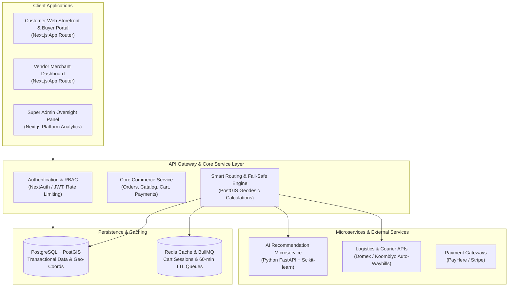
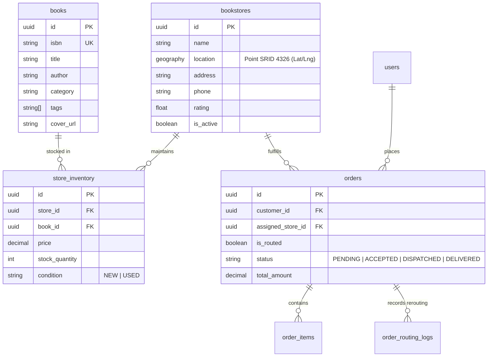

# 📚 Multi-Vendor Bookstore Platform & Smart Auto-Routing Network
### Decentralized Multi-Vendor Marketplace with Geo-Intelligent Order Routing & AI Personalization

[](https://nextjs.org/)
[](https://www.typescriptlang.org/)
[](https://tailwindcss.com/)
[](https://postgis.net/)
[](https://fastapi.tiangolo.com/)
[](https://redis.io/)

---

## 📖 Executive Summary & Core Concept

The **Multi-Vendor Bookstore Platform** is a decentralized, geo-intelligent book marketplace connecting independent bookstores across Sri Lanka into a unified digital fulfillment network. 

In traditional book e-commerce platforms, sales are permanently lost when a specific bookshop runs out of inventory. This platform introduces a decoupled inventory architecture and an automated **Smart Out-of-Stock Auto-Routing Engine**:

> **When a customer orders a book that is out of stock (`stock_quantity = 0`) at their selected bookstore, the system automatically detects inventory across neighboring network partner shops using PostGIS geospatial proximity and facilitates seamless order rerouting.**

---

## 💡 Core Value Proposition

| Stakeholder | Value Delivered |
| :--- | :--- |
| **For Readers / Buyers** | Eliminates the need to physically visit multiple shops. Offers real-time stock comparison, transparent pricing, distance calculations, and express local delivery. |
| **For Bookstore Vendors** | Small independent bookshops gain immediate digital reach. Inter-store order routing preserves customer loyalty and monetizes missed sales opportunities. |
| **AI Personalization** | Real-time content-based recommendation engine recommending relevant titles based on past purchasing vectors and author/category affinities. |

---

## 🚀 Key Features

### 1. 📍 Inventory Routing & Out-of-Stock Workflow
- **Decoupled Inventory Aggregation:** Global catalog query resolves against a Master Books Catalog using standard ISBN-10 / ISBN-13 metadata indices.
- **Local Stock Evaluation:** If chosen vendor's local stock $> 0$, standard checkout is served.
- **Proximity & Cost Ranking:** If local stock is $0$, the routing engine ranks partner vendors with stock using three weighted parameters:
  - **Distance (Geodesic):** Nearest physical shop coordinates computed natively via PostGIS `ST_Distance`.
  - **Total Landed Cost:** Book unit price $+$ calculated courier dispatch rate.
  - **Vendor SLA:** Historical dispatch time rating and fulfillment success rate.
- **Customer Choice:** Customers can accept the recommended alternative partner with a single click or allow the platform to auto-route.

### 2. ⏱️ 60-Minute Fail-Safe Mechanism
If an assigned secondary vendor fails to accept the routed order within 60 minutes:
1. The order automatically cascades to the next best partner shop in the network.
2. If no viable partners remain, an automated full refund or store credit is triggered instantly.

### 3. 👤 Customer Experience & Buyer Portal (Dashboard)
- **Universal Multi-Store Catalog:** Typo-tolerant search across titles, authors, categories, and ISBNs.
- **Live Order & Routing Tracking:** Complete transparency into order lifecycle, including which bookstore fulfilled the order and real-time courier consignment checkpoints.
- **Saved Geolocation Pins:** Store multiple delivery locations (Home, Work) with GPS pins for accurate nearest-shop routing.
- **Order History & Invoices:** Instant PDF invoices and transaction records.
- **Personalized Reading Hub & Wishlist:** Curated recommendations powered by AI.
- **Vendor Ratings & Reviews:** Customer feedback directly informs the vendor SLA ranking algorithm.

### 4. 🏪 Vendor Merchant Portal
- **Map-Based Onboarding:** Merchant registration with interactive map coordinate picker for physical store location.
- **Store-Level Inventory Manager:** Search the master catalog, set local prices, manage stock quantities, and flag condition (`NEW` or `USED`).
- **Live Dispatch Center:** Manage incoming direct and routed orders with active countdown timers for SLA compliance.

### 5. 🤖 AI Recommendation Microservice (Python FastAPI)
- **Content-Based Vector Space Modeling:** Implements **TF-IDF Vectorizer** and **Cosine Proximity** (`scikit-learn`) over author, category, and thematic tags to eliminate the Cold-Start dilemma.
- **Preference Vectors:** Aggregates user purchase history into a mean embedding vector to score and rank candidate catalog items.

### 6. 🚚 Domestic Logistics Integration
- Automated API consignment dispatch, tracking waybill creation, and status webhooks integrated with local couriers (Domex, Koombiyo).

---

## 🏛️ System Architecture

The architecture utilizes a modular, microservices-ready decoupled pattern. Core transaction flows are strictly separated from compute-intensive recommendation and spatial routing routines.



---

## 🗄️ Relational & Spatial Database Schema Design

The schema separates universal book definitions from individual bookstore holdings to allow multiple sellers per title.



### PostGIS Geodesic Spatial Query Example:
```sql
SELECT 
    s.id AS store_id,
    s.name AS store_name,
    s.phone AS store_phone,
    s.rating AS vendor_rating,
    inv.price AS book_price,
    inv.stock_quantity,
    ROUND((ST_Distance(s.location, ST_MakePoint(:user_lng, :user_lat)::geography) / 1000)::numeric, 2) AS distance_km,
    (inv.price + (ROUND((ST_Distance(s.location, ST_MakePoint(:user_lng, :user_lat)::geography) / 1000)::numeric, 2) * 50) + 300) AS total_landed_cost
FROM bookstores s
JOIN store_inventory inv ON s.id = inv.store_id
WHERE inv.book_id = :requested_book_id
  AND inv.stock_quantity > 0
  AND s.is_active = TRUE
ORDER BY 
  distance_km ASC,
  total_landed_cost ASC
LIMIT 3;
```

---

## 🛠️ Technology Stack

| Layer / Role | Selected Technology | Design Justification |
| :--- | :--- | :--- |
| **Storefront & Portals** | Next.js 14+ (React), Tailwind CSS | Server-Side Rendering (SSR) ensures optimal SEO indexation for book titles. Highly responsive UI. |
| **Core Backend & APIs** | Next.js App Router / Node.js | Robust transaction boundaries, strong typing with TypeScript, and seamless microservice communication. |
| **Geospatial Database** | PostgreSQL + PostGIS | Enables native spatial SQL queries (`ST_Distance`, `ST_DWithin`) to compute radial proximity. |
| **AI Recommendation** | Python (FastAPI + Scikit-learn) | Optimized for vector calculations, matrix operations, and high-concurrency read queries. |
| **In-Memory Cache & Queues**| Redis + BullMQ | Ephemeral cart state, fast title caching, and reliable 60-minute fail-safe order cascade timers. |
| **Logistics Integration** | Local Courier APIs (Domex / Koombiyo) | Automated consignment dispatch, waybill creation, and tracking webhooks. |

---

## 📂 Project Directory Structure

```text
book-ordering-system/
├── docs/                                          # Architecture specifications & roadmap
│   ├── Multi-Vendor Bookstore Implementation Plan (Sinhala).html
│   ├── Multi-Vendor Bookstore Implementation Plan (Sinhala).md
│   ├── Multi-Vendor Bookstore System Design Specification (Sinhala).pdf
│   └── Multi-Vendor Bookstore System Design Specification.pdf
├── src/
│   ├── app/                                       # Next.js App Router
│   │   ├── (storefront)/                          # Catalog browsing, Cart, Checkout
│   │   ├── (dashboard)/
│   │   │   ├── buyer/                             # Buyer Portal (Orders, Tracking, Wishlist)
│   │   │   └── vendor/                            # Vendor Portal (Inventory, Map, Dispatch)
│   │   └── api/                                   # REST API endpoints & Routing Engine
│   ├── components/                                # Reusable modular UI components
│   │   ├── marketplace/                           # Book Cards, Filters, Search
│   │   ├── routing/                               # Alternative Store Modal & Map
│   │   └── ui/                                    # Buttons, Modals, Badges
│   ├── lib/                                       # DB Client, PostGIS utilities, Helpers
│   └── server/                                    # Core business logic services
├── ai-service/                                    # Python FastAPI Microservice
│   ├── main.py                                    # TF-IDF & Cosine Similarity endpoints
│   └── requirements.txt
├── .gitignore
├── README.md
└── package.json
```

---

## 📑 Documentation

Full architectural specifications, mathematical formulations, and engineering roadmap documents are available in the [`docs/`](./docs/) directory:
- 🌐 [Printable HTML Implementation Plan (Sinhala)](./docs/Multi-Vendor%20Bookstore%20Implementation%20Plan%20(Sinhala).html)
- 📝 [Markdown Implementation Plan (Sinhala)](./docs/Multi-Vendor%20Bookstore%20Implementation%20Plan%20(Sinhala).md)
- 📕 [System Design Specification - English (PDF)](./docs/Multi-Vendor%20Bookstore%20System%20Design%20Specification.pdf)
- 📗 [System Design Specification - Sinhala (PDF)](./docs/Multi-Vendor%20Bookstore%20System%20Design%20Specification%20(Sinhala).pdf)

---

## 🚦 6-Phase Engineering Roadmap

- [ ] **Phase 1: Project Setup & Spatial Database:** Next.js scaffolding, PostgreSQL with PostGIS extension, ORM schema migrations, and initial seed data with Sri Lankan bookstores.
- [ ] **Phase 2: Vendor Merchant Portal:** Merchant registration, interactive map location picker, master catalog search, and store inventory stock/price sync.
- [ ] **Phase 3: Customer Marketplace & Buyer Dashboard:** Book search, multi-store price/distance comparison, multi-vendor cart, checkout, and live order tracking.
- [ ] **Phase 4: Smart Out-of-Stock Auto-Routing:** PostGIS proximity ranking query, interactive alternative store modal, and 60-minute fail-safe order cascade queue.
- [ ] **Phase 5: AI Recommendation Microservice:** FastAPI microservice with TF-IDF vector space modeling and cosine similarity scoring.
- [ ] **Phase 6: Logistics Integration & Super Admin:** Domestic courier API auto-waybills and marketplace platform analytics.

---

## 💻 Getting Started Locally

### Prerequisites:
- **Node.js**: v18.0.0 or higher
- **PostgreSQL**: v14+ with `postgis` extension enabled
- **Python**: v3.10+ (for the AI recommendation microservice)

### Installation:
```bash
# 1. Clone the repository
git clone <your-repo-url>
cd "Book ordering System"

# 2. Install dependencies
npm install

# 3. Configure environment variables
cp .env.example .env.local

# 4. Run database migrations
npx prisma db push

# 5. Start the development server
npm run dev
```

Open [http://localhost:3000](http://localhost:3000) in your browser to view the application.

---

## 📄 License
This project is licensed under the MIT License - see the LICENSE file for details.
