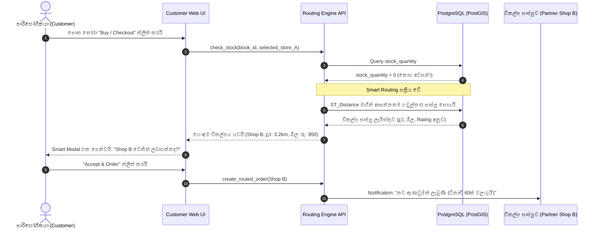

# බහු-විකුණුම්කාර පොත් ඇණවුම් පද්ධතිය (Multi-Vendor Bookstore System)
## පියවරෙන් පියවර සංවර්ධන හා ක්‍රියාත්මක කිරීමේ සැලැස්ම (Step-by-Step Implementation & Engineering Roadmap)

**ලේඛන අනුවාදය:** 1.0.0  
**භාෂාව:** සිංහල (Sinhala Guide with Technical Specifications)  
**තත්ත්වය:** අනුමත සංවර්ධන සැලැස්ම (Approved Implementation Plan)  
**දිනය:** 2026-10-25  

---

## 1. විධායක සාරාංශය (Executive Summary)

මෙම ලේඛනය මඟින් දිවයින පුරා විසිරී ඇති පොත් සාප්පු ජාලගත කරමින් ක්‍රියාත්මක වන **බහු-විකුණුම්කාර ඩිජිටල් පොත් වෙළඳපොළක් (Decentralized Multi-Vendor Bookstore Platform)** මුල සිටම ගොඩනැගීමේ පියවරෙන් පියවර තාක්ෂණික සැලැස්ම සවිස්තරාත්මකව ඉදිරිපත් කරයි.

### 🌟 පද්ධතියේ මූලික සුවිශේෂත්වය (Core Innovation - Smart Out-of-Stock Routing):
සාමාන්‍ය eCommerce අඩවියක යම් පොතක තොග අවසන් වූ විට (Out of Stock), පාරිභෝගිකයාට එම පොත මිලදී ගැනීමට නොහැකි වී ආපසු යාමට සිදුවේ. නමුත් මෙම පද්ධතිය තුළ:
1. පාරිභෝගිකයා තෝරාගත් සාප්පුවේ පොතක් නොමැති වූ විට (`stock_quantity == 0`), පද්ධතියේ **Smart Routing Engine** එක ක්ෂණිකව ක්‍රියාත්මක වේ.
2. **PostGIS භූගෝලීය දත්ත පද්ධතිය** මඟින් පාරිභෝගිකයාගේ ලිපිනයට ආසන්නතම හවුල්කාර සාප්පු ජාලය පරීක්ෂා කරයි.
3. දුර, පොතේ මිල, කුරියර් ප්‍රවාහන ගාස්තු සහ සාප්පුවේ ශ්‍රේණිගත කිරීම (Rating) සංසන්දනය කර හොඳම විකල්පය පාරිභෝගිකයාට ලබාදේ.
4. පාරිභෝගිකයා තහවුරු කළ විට, ඇණවුම අදාළ විකල්ප සාප්පුව වෙත ස්වයංක්‍රීයව මාරු වේ (Auto-Routed).
5. මිනිත්තු 60ක් ඇතුළත එම සාප්පුව භාණ්ඩය පිළිනොගතහොත්, ඇණවුම ඊළඟ හොඳම සාප්පුවට ස්වයංක්‍රීයව මාරු කෙරේ (60-minute Fail-Safe Mechanism).

---

## 2. පද්ධති ගෘහ නිර්මාණ ශිල්පය (System Architecture)

පද්ධතිය එකිනෙකට ස්වාධීනව ක්‍රියාත්මක වන ප්‍රධාන මොඩියුල (Decoupled Modular Architecture) 4කින් සමන්විත වේ:

```
+-----------------------------------------------------------------------------------+
|                        පරිශීලක අතුරුමුහුණත් (Client Applications)                  |
|  - Customer Web Storefront & Buyer Dashboard (Next.js)                             |
|  - Vendor Merchant Dashboard (Next.js)                                            |
|  - Super Admin Platform Oversight         - Mobile Friendly Responsive UI         |
+-----------------------------------------------------------------------------------+
                                          |
                                    (HTTPS / REST / JWT)
                                          v
+-----------------------------------------------------------------------------------+
|                           API Gateway & Core Application Layer                    |
|  - Authentication & Authorization (NextAuth / JWT Role-based Access)               |
|  - Catalog & Search Engine (Master ISBN Index)                                     |
|  - Cart & Multi-Store Order Processing Engine                                     |
|  - Smart Out-of-Stock Routing & Priority Cascade Engine                           |
+-----------------------------------------------------------------------------------+
                   |                                            |
                   v                                            v
+------------------------------------+       +--------------------------------------+
|       දත්ත සමුදාය (Persistence)       |       |       බාහිර සේවා (External Microservices)   |
| - PostgreSQL + PostGIS (Geospatial)|       | - AI Recommendation (Python FastAPI) |
| - Books, Stores, Inventory, Orders |       | - Logistics API (Domex / Koombiyo)   |
| - Redis (Cart, 60-min TTL Queues)  |       | - Payment Gateway (PayHere / Stripe) |
+------------------------------------+       +--------------------------------------+
```

---

## 3. දත්ත සමුදාය සැලැස්ම (Multi-Vendor Relational & Spatial Database Schema)

පද්ධතිය ආරම්භයේ සිටම දත්ත සමුදාය වගු 5ක් හරහා නිවැරදිව වෙන් කර ක්‍රියාත්මක වේ:

### වගුව 1: ගෝලීය පොත් නාමාවලිය (`books`)
සියලුම සාප්පුවලට පොදු වූ පොත්වල නිල දත්ත මෙහි ගබඩා වේ.
| තීරු නම (Column) | දත්ත වර්ගය (Data Type) | සීමාවන් (Constraints) | විස්තරය |
| :--- | :--- | :--- | :--- |
| `id` | UUID | PRIMARY KEY | පොත හඳුනාගැනීමේ අනන්‍ය අංකය |
| `isbn` | VARCHAR(20) | UNIQUE, NOT NULL | ජාත්‍යන්තර සම්මත ISBN-10 / ISBN-13 අංකය |
| `title` | VARCHAR(255) | NOT NULL, INDEXED | පොතේ නම |
| `author` | VARCHAR(255) | NOT NULL, INDEXED | කතුවරයාගේ නම |
| `category` | VARCHAR(100) | NOT NULL | ප්‍රවර්ගය (නවකතා, පරිවර්තන, විද්‍යා, ළමා) |
| `tags` | TEXT[] | NULLABLE | AI Recommendation සඳහා යොදාගන්නා Tags |
| `cover_url` | TEXT | NULLABLE | පොතේ පිටකවරයේ ඡායාරූපය |

### වගුව 2: පොත් සාප්පු ලැයිස්තුව (`bookstores`)
ජාලගත වී ඇති සියලුම හවුල්කාර පොත් සාප්පු වල තොරතුරු.
| තීරු නම (Column) | දත්ත වර්ගය (Data Type) | සීමාවන් (Constraints) | විස්තරය |
| :--- | :--- | :--- | :--- |
| `id` | UUID | PRIMARY KEY | සාප්පුවේ අනන්‍ය අංකය |
| `name` | VARCHAR(255) | NOT NULL | වෙළඳ නාමය (උදා: Sarasavi Bookshop) |
| `location` | GEOGRAPHY(Point, 4326) | NOT NULL | GPS පිහිටීම (Latitude, Longitude) |
| `address` | TEXT | NOT NULL | භෞතික ලිපිනය සහ නගරය |
| `phone` | VARCHAR(20) | NOT NULL | දුරකථන අංකය |
| `rating` | DECIMAL(3,2) | DEFAULT 5.0 | සාප්පුවේ විශ්වසනීයත්ව ශ්‍රේණිය (1.0 - 5.0) |
| `is_active` | BOOLEAN | DEFAULT TRUE | සාප්පුව සක්‍රීයද නැද්ද යන්න |

### වගුව 3: එක් එක් සාප්පුවේ තොග සහ මිල (`store_inventory`)
එක් එක් සාප්පුව සතු පොත් පිටපත් සංඛ්‍යාව සහ විකුණුම් මිල.
| තීරු නම (Column) | දත්ත වර්ගය (Data Type) | සීමාවන් (Constraints) | විස්තරය |
| :--- | :--- | :--- | :--- |
| `id` | UUID | PRIMARY KEY | තොග පේළි අනන්‍ය අංකය |
| `store_id` | UUID | FOREIGN KEY (bookstores) | අදාළ පොත් සාප්පුව |
| `book_id` | UUID | FOREIGN KEY (books) | අදාළ පොත |
| `price` | NUMERIC(10,2) | NOT NULL, > 0 | අදාළ සාප්පුවේ විකුණුම් මිල (රුපියල්) |
| `stock_quantity` | INTEGER | NOT NULL, >= 0 | පවතින සැබෑ පිටපත් සංඛ්‍යාව |
| `condition` | VARCHAR(20) | DEFAULT 'NEW' | තත්ත්වය: NEW (අලුත්) හෝ USED (පාවිච්චි කළ) |

### වගුව 4: ඇණවුම් (`orders`)
| තීරු නම (Column) | දත්ත වර්ගය (Data Type) | සීමාවන් (Constraints) | විස්තරය |
| :--- | :--- | :--- | :--- |
| `id` | UUID | PRIMARY KEY | ඇණවුමේ අනන්‍ය අංකය |
| `customer_name` | VARCHAR(255) | NOT NULL | පාරිභෝගිකයාගේ නම |
| `customer_phone`| VARCHAR(20) | NOT NULL | දුරකථන අංකය |
| `delivery_location`| GEOGRAPHY(Point, 4326)| NOT NULL | පාරිභෝගිකයාගේ GPS ස්ථානය |
| `assigned_store_id`| UUID | FOREIGN KEY (bookstores) | ඇණවුම භාරගත් සාප්පුව |
| `is_routed` | BOOLEAN | DEFAULT FALSE | වෙනත් සාප්පුවකින් මාරු වූවක්ද යන්න |
| `status` | VARCHAR(30) | NOT NULL | PENDING, ACCEPTED, DISPATCHED, DELIVERED |
| `total_amount` | NUMERIC(10,2) | NOT NULL | සම්පූර්ණ මුදල (පොතේ මිල + කුරියර් ගාස්තුව) |

### වගුව 5: ඇණවුම් මාරුවීම් සටහන (`order_routing_logs`)
| තීරු නම (Column) | දත්ත වර්ගය (Data Type) | විස්තරය |
| :--- | :--- | :--- |
| `id` | UUID | ලොග් අනන්‍ය අංකය |
| `order_id` | UUID | අදාළ ඇණවුම |
| `from_store_id` | UUID | තොග නොමැති වූ මුල් සාප්පුව |
| `to_store_id` | UUID | ඇණවුම යොමු කළ විකල්ප සාප්පුව |
| `distance_km` | NUMERIC(6,2) | සාප්පු අතර දුර හෝ පාරිභෝගිකයාට ඇති දුර |
| `routed_at` | TIMESTAMP | මාරු කළ වේලාව |

---

## 4. Smart Out-of-Stock Auto-Routing තාක්ෂණික ක්‍රමවේදය



### PostGIS Geodesic SQL සූත්‍රය:
```sql
SELECT 
    s.id AS store_id,
    s.name AS store_name,
    s.phone AS store_phone,
    s.rating AS vendor_rating,
    inv.price AS book_price,
    inv.stock_quantity,
    ROUND((ST_Distance(s.location, ST_MakePoint(:user_lng, :user_lat)::geography) / 1000)::numeric, 2) AS distance_km,
    (inv.price + (ROUND((ST_Distance(s.location, ST_MakePoint(:user_lng, :user_lat)::geography) / 1000)::numeric, 2) * 50) + 300) AS total_landed_cost
FROM bookstores s
JOIN store_inventory inv ON s.id = inv.store_id
WHERE inv.book_id = :requested_book_id
  AND inv.stock_quantity > 0
  AND s.is_active = TRUE
ORDER BY 
  distance_km ASC,
  total_landed_cost ASC
LIMIT 3;
```

---

## 5. පියවරෙන් පියවර සංවර්ධන අදියර 6 (6-Phase Implementation Roadmap)

### 🗓️ අදියර 1: මූලික යටිතල පහසුකම් සහ දත්ත සමුදාය (Core Infrastructure & Spatial DB)
* **කාලය:** සති 1 - 2
* **ප්‍රධාන කාර්යයන්:**
  1. Next.js 14+ (App Router, TypeScript) සහ Tailwind CSS මූලික Project එක සැකසීම.
  2. PostgreSQL Server එකෙහි `CREATE EXTENSION postgis;` සක්‍රීය කිරීම.
  3. Prisma ORM / SQL DDL මඟින් `books`, `bookstores`, `store_inventory`, `orders` Tables සෑදීම.
  4. ප්‍රධාන පොත් සාප්පු 4ක් සැබෑ GPS Coordinates සහිතව Seed Data ලෙස ඇතුළත් කිරීම:
     - *Sarasavi Bookshop (Nugegoda)* - Lat: 6.8728, Lng: 79.8898
     - *MD Gunasena (Pettah)* - Lat: 6.9366, Lng: 79.8530
     - *Sadeepa Bookshop (Borella)* - Lat: 6.9147, Lng: 79.8778
     - *Grantha.lk Fulfillment (Kottawa)* - Lat: 6.8412, Lng: 79.9654
  5. පොත් 25-30ක් Catalog එකට දමා විවිධ සාප්පුවල තොග (සමහර සාප්පුවල stock = 0 කරමින්) සකස් කිරීම.

---

### 🗓️ අදියර 2: සාප්පු හිමියන්ගේ පරිපාලක පුවරුව (Vendor Portal Dashboard)
* **කාලය:** සති 2 - 3
* **ප්‍රධාන කාර්යයන්:**
  1. Vendor Authentication & Role-based Access Control (RBAC).
  2. **Store Location Setup:** සාප්පු හිමියාට Map එක මත ක්ලික් කර හෝ GPS මඟින් තම සාප්පුවේ පිහිටීම ලකුණු කිරීමේ පහසුකම.
  3. **Multi-Store Inventory Management:**
     - Master Catalog එකෙන් පොතක් තෝරා තමන්ගේ සාප්පුවේ විකුණුම් මිල සහ Stock Count යාවත්කාලීන කිරීම.
     - අලුත් පොත් Master Catalog එකට යෝජනා කිරීම (Book Submission).
  4. **Live Order Center:** තමන්ගේ සාප්පුව වෙත පාරිභෝගිකයන්ගෙන් සෘජුව එන ඇණවුම් සහ Smart Routing හරහා එන ඇණවුම් බලාගත හැකි Order Board එක.

---

### 🗓️ අදියර 3: පාරිභෝගික වෙළඳපොළ සහ Buyer Dashboard (Customer Storefront & Buyer Portal)
* **කාලය:** සති 3 - 4
* **ප්‍රධාන කාර්යයන්:**
  1. **Modern Bookstore Homepage:** Hero section, Featured Books, Sinhala & English category filters.
  2. **Multi-Store Price Comparison:** එකම පොත සාප්පු කිහිපයක විවිධ මිල ගණන් වලට ඇති විට, සාප්පුව, මිල සහ දුර සංසන්දනය කර පෙන්වන Comparison View එක.
  3. **Real-time Stock Badges:** "In Stock at Nugegoda", "Out of Stock at Borella" ආදී තත්ත්වයන් පැහැදිලිව පෙන්වීම.
  4. **Multi-Store Shopping Cart:** විවිධ සාප්පු වලින් වුවද පොත් Cart එකට දමා Checkout කිරීමේ හැකියාව.
  5. **පාරිභෝගික පුවරුව (Buyer Dashboard):**
     - **Live Order & Routing Tracking:** ඇණවුමේ වත්මන් තත්ත්වය සහ වෙනත් සාප්පුවකට මාරු වූයේද (Routed Status) යන්න සජීවීව බැලීම.
     - **Saved Delivery Addresses (GPS Pins):** පාරිභෝගිකයාගේ නිවසේ සහ කාර්යාලයේ GPS පිහිටීම් සුරැකීම (PostGIS මඟින් ළඟම කඩවල් සෙවීමට උපකාරී වේ).
     - **Order History & Invoices:** පෙර මිලදී ගත් පොත් සහ Digital Invoice බාගත කිරීම.
     - **Wishlist & Reading Hub:** පසුව මිලදී ගැනීමට සුරැකි පොත් සහ පුද්ගලීකරණය කළ AI නිර්දේශ.
     - **Store Reviews & Rating:** සාප්පු වල සේවාව සහ බෙදාහැරීමේ වේගය සඳහා ලකුණු දීම (මෙය Routing Engine එකේ SLA ලකුණු සඳහා යොදාගැනේ).

---

### 🗓️ අදියර 4: Smart Out-of-Stock Auto-Routing සහ Fail-Safe Engine
* **කාලය:** සති 4 - 5
* **ප්‍රධාන කාර්යයන්:**
  1. **Smart Routing Algorithm API:** තෝරාගත් සාප්පුවේ තොග නොමැති විට PostGIS Distance + Total Landed Cost ගණනය කරන API එක.
  2. **Frontend Smart Routing Modal:** 
     - පාරිභෝගිකයාට ක්ෂණිකව පෙනෙන Interactive Popup එක: *"ඔබ තෝරාගත් සාප්පුවේ මෙම පොත අවසන්. නමුත් කි.මී. 3.2ක් දුරින් පිහිටි Sarasavi සාප්පුවේ රු. 950කට ඇත. ඇණවුම මාරු කරන්නද?"*
  3. **1-Click Transfer:** එක ක්ලික් එකකින් ඇණවුම අදාළ සාප්පුවට Auto-Assign කිරීම.
  4. **60-Minute Fail-Safe Queue (Redis / Background Worker):**
     - මාරු කළ සාප්පුව මිනිත්තු 60ක් ඇතුළත පිළිනොගතහොත්, ඇණවුම 2nd Best Partner වෙත ස්වයංක්‍රීයව Cascade කිරීම.

---

### 🗓️ අදියර 5: AI බුද්ධිමත් පොත් නිර්දේශ සේවාව (FastAPI Recommendation Microservice)
* **කාලය:** සති 5 - 6
* **ප්‍රධාන කාර්යයන්:**
  1. Python FastAPI microservice එකක් පිහිටුවීම.
  2. `sklearn.feature_extraction.text.TfidfVectorizer` මඟින් Author + Category + Tags සංයෝජනය කර Vector Space Model එකක් හැදීම.
  3. පාරිභෝගිකයා මිලදී ගත් හෝ සොයන ලද පොත්වල සාමාන්‍ය රුචිකත්ව දෛශිකය (User Mean Vector) ගණනය කර Cosine Similarity මඟින් වඩාත්ම ගැළපෙන පොත් 4ක් නිර්දේශ කිරීම.
  4. Next.js වෙබ් අඩවියේ *"ඔබ වෙනුවෙන්ම තෝරාගත් පොත් (Recommended For You)"* ලෙස පෙන්වීම.

---

### 🗓️ අදියර 6: ප්‍රවාහන ඒකාබද්ධතාව සහ Super Admin Analytics (Logistics & Polish)
* **කාලය:** සති 6 - 7
* **ප්‍රධාන කාර්යයන්:**
  1. දේශීය කුරියර් සේවා (Domex / Koombiyo API) සමඟ සම්බන්ධ වී ඇණවුම් තහවුරු වූ වහාම ස්වයංක්‍රීය Waybill අංකයක් හැදීම.
  2. පාරිභෝගිකයාට Live Delivery Tracking පිටුවක් ලබා දීම.
  3. **Super Admin Dashboard:** මුළු දිවයිනේම සියලුම සාප්පුවල දෛනික විකුණුම්, සාප්පු අතර ස්වයංක්‍රීයව මාරු වූ ඇණවුම් ප්‍රතිශතය (Routing Success Rate) පෙන්වන Analytics Dashboard එකක්.

---

## 6. තාක්ෂණික මෙවලම් සාරාංශය (Technical Stack Summary)

| කොටස (Layer) | තෝරාගත් තාක්ෂණය | ප්‍රයෝජනය සහ හේතුව |
| :--- | :--- | :--- |
| **Frontend & UI** | Next.js (React) + Tailwind CSS | වේගවත් SEO, Server Components, සහ modern responsive UI |
| **Backend & APIs** | Next.js API Routes / Node.js | Robust order transaction processing සහ API endpoints |
| **Database** | PostgreSQL + PostGIS | පාරිභෝගිකයාගේ GPS ස්ථානයට ළඟම සාප්පු සෙවීමේ Spatial Queries |
| **AI Microservice** | Python (FastAPI + Scikit-learn) | TF-IDF & Cosine Similarity පදනම් කරගත් පොත් නිර්දේශ |
| **Cache & Queues**| Redis | Cart sessions සහ විනාඩි 60 Fail-safe order cascade timers |
| **Logistics** | Domestic Courier APIs | ස්වයංක්‍රීය Waybill පත් සැකසීම සහ Live Tracking |

---

## 7. පළමු පියවර ලෙස අදම ආරම්භ කරන්නේ කෙසේද?

මෙම ව්‍යාපෘතිය ආරම්භ කිරීම සඳහා ප්‍රථමයෙන්ම:
1. මෙම Workspace එක තුළ **Next.js Full-Stack Application** එකක් Initialize කිරීම.
2. Master Books Catalog, Partner Bookstores, සහ Inventory සම්බන්ධ කරමින් **Interactive Multi-Vendor Storefront Prototype** එක සකස් කිරීම.
3. Out-of-Stock අවස්ථාවකදී **Smart Routing Modal එක සහ විකල්ප සාප්පු පෙන්වීමේ ක්‍රියාවලිය** සජීවීව ක්‍රියාත්මක කිරීම.
